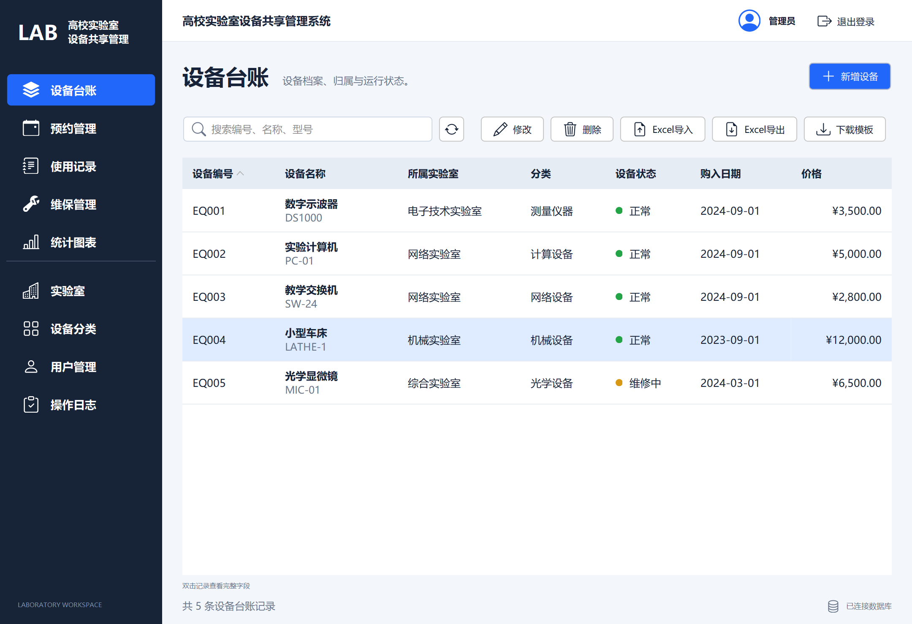
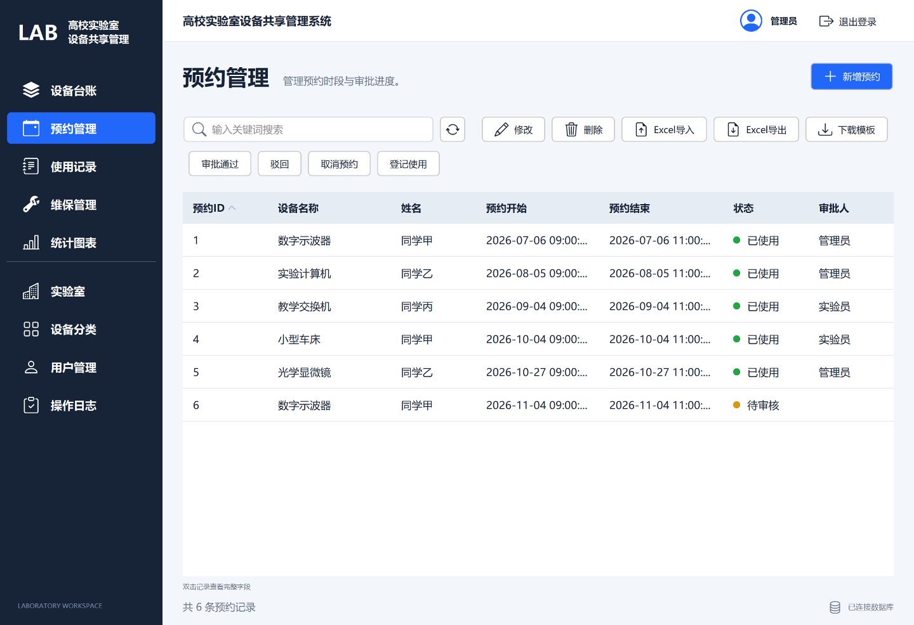
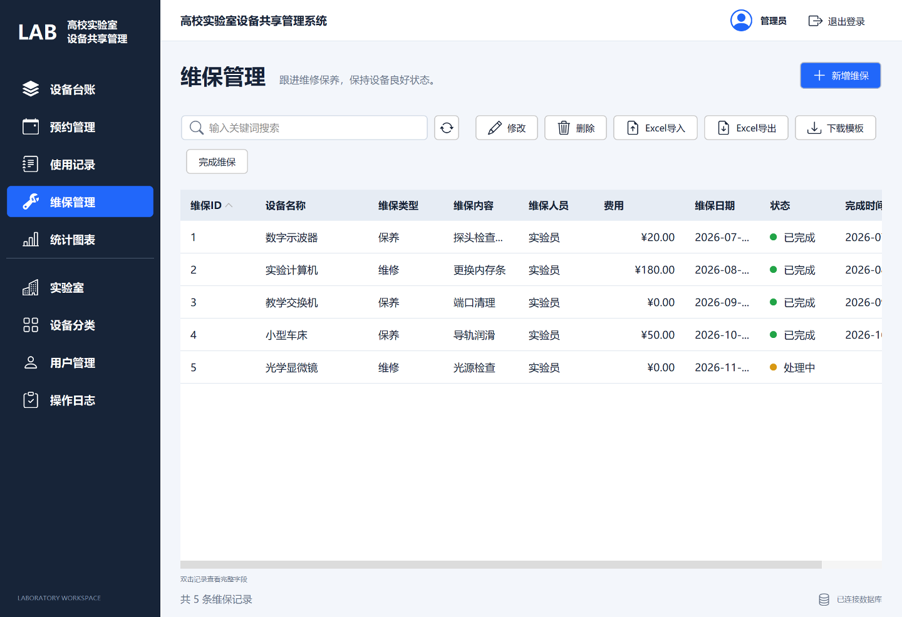
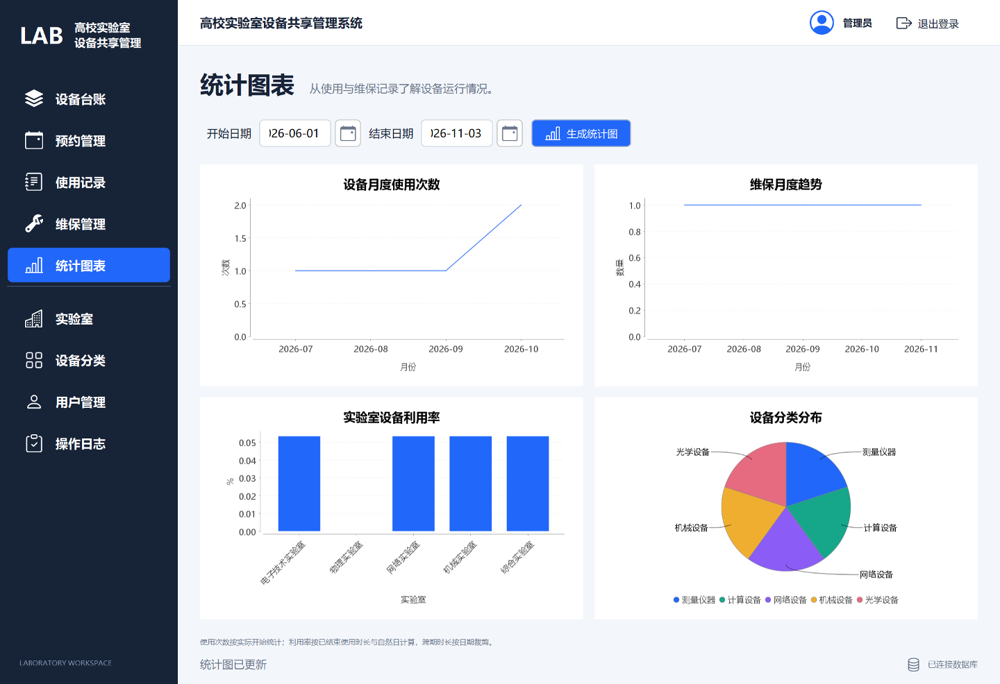

# 高校实验室设备共享预约与维保管理系统

这是我的 **MySQL 数据库课程设计作品**，使用 Java Swing、JDBC 和 MySQL 实现一套可以运行的实验室设备管理桌面程序。

项目以实验室设备的「台账 → 预约 → 审批 → 实际使用 → 维修保养」为业务线，重点练习关系模型、主外键、视图、存储过程、触发器、事务和统计查询，并提供 GUI 操作及真实的 Excel 文件导入导出。采用适合课程演示的简单架构，运行时不需要 Web 服务器。



## 课程设计背景

本项目依据《课程设计任务与成果要求（数据库应用与 GUI 程序设计方向）》完成。课程要求使用 Java GUI 和 MySQL 开发管理信息系统，包含至少五张表、外键约束、视图与存储过程、图表、增删改查、统计分析，以及 Excel 数据交换。

| 课程要求 | 项目中的实现 |
| --- | --- |
| 至少 5 张数据表 | 8 张业务表，覆盖用户、实验室、分类、设备、预约、使用、维保与日志 |
| 各表至少 5 条记录 | 初始化各表不少于 5 条，预约 6 条；公开种子数据为教学模拟记录 |
| 外键、视图和存储过程 | 主外键与唯一约束、4 个视图、3 个存储过程、2 个触发器 |
| 数据增删改查与统计 | 桌面列表、表单、关键词查询、排序及按角色限制的业务操作 |
| 折线图、趋势图等可视化 | 使用次数折线图、维保趋势图、利用率柱状图、设备分类饼图 |
| Excel 导入与导出 | 设备、预约、维保三类模板导入；列表查询结果导出；校验失败整批回滚 |
| 可运行成果和源码 | Maven 工程、内嵌 SQL 脚本，可构建包含 Java 依赖的可执行 JAR |

课程还要求真实、准确的数据。**当前公开版本使用模拟数据，不代表学校真实资产或使用记录，也不能据此认定真实数据要求已满足。** 正式课程验收仍需补充经允许使用的真实资料及来源。

六章报告结构与提交要求见 [课程设计说明](docs/课程设计说明.md)。

## 功能

| 模块 | 主要内容 |
| --- | --- |
| 登录与角色 | 管理员、实验员、普通用户；密码使用 PBKDF2 SHA-256 加盐哈希 |
| 设备台账 | 增删改查、实验室与分类关联、价格和日期校验、预约占用状态 |
| 基础资料 | 实验室、设备分类和用户管理 |
| 预约管理 | 时段冲突检查、审批、驳回、取消；普通用户操作自己的记录 |
| 使用记录 | 审批后登记实际使用，记录开始、结束时间 |
| 维保管理 | 维修和保养、处理中与已完成状态、触发器联动设备状态 |
| Excel | 模板下载、导入、查询结果导出、错误行号提示和整批回滚 |
| 统计图表 | 使用次数、维保趋势、实验室设备利用率、设备分类分布 |
| 操作日志 | 记录登录和写操作，管理员查看 |

日期使用现成的 LGoodDatePicker 日历，时间采用 Swing 原生 `JSpinner.DateEditor`。时、分、秒可分别编辑；选中秒后可以直接输入或通过上下方向键逐秒调整。界面样式复用 FlatLaf。

## 技术栈与架构

| 用途 | 技术 |
| --- | --- |
| 语言与构建 | Java，JDK 17 构建，Maven 3.9 |
| 桌面界面 | Swing、FlatLaf 3.5.4、LGoodDatePicker 11.2.1 |
| 数据库访问 | MySQL、JDBC、Connector/J 8.4.0 |
| Excel | Apache POI 5.3.0 |
| 统计图表 | JFreeChart 1.5.5 |
| 自动测试 | JUnit Jupiter 5.11.4 |


业务 SQL 集中在 `LabService` 中，由 `Db` 执行。表单和 Excel 导入复用相同的业务校验，减少不同入口之间的规则差异。

## 数据库设计

| 数据表 | 用途 |
| --- | --- |
| `tb_user` | 登录用户与业务角色 |
| `tb_lab` | 实验室基础资料 |
| `tb_device_category` | 设备分类 |
| `tb_device` | 设备台账 |
| `tb_booking` | 预约计划和审批信息 |
| `tb_usage` | 实际使用记录，通过预约关联用户和设备 |
| `tb_maintenance` | 维修保养记录、状态和完成时间 |
| `tb_log` | 操作日志 |

数据库对象包括：

- 视图：`v_device_status`、`v_booking_detail`、`v_usage_detail`、`v_maintenance_summary`。
- 存储过程：`sp_check_time_conflict`、`sp_approve_booking`、`sp_monthly_usage_stat`。
- 触发器：`trg_maintenance_insert`、`trg_maintenance_update`。

几个主要业务规则：

- 审批通过只改变预约状态；登记实际使用后才创建使用记录，每个预约最多一条。
- 预约按左闭右开区间判断冲突：`09:00—10:00` 与 `10:00—11:00` 可以相邻，`09:30—10:30` 会冲突。
- 待审核、通过和已使用的预约参与冲突检查；取消和驳回释放时段。
- 同一设备所有处理中维保完成后才恢复正常，开始维保前需先结束实际使用。
- Excel 文件中任何一行失败，整批导入回滚；业务记录和对应日志一起提交或回滚。

实体关系、状态图和演示 SQL 见 [数据库设计与演示](docs/数据库设计与演示.md)。

## 从源码运行

### 1. 准备环境与构建

推荐使用 **JDK 17、Maven 3.9、MySQL 5.7**。本机验证的数据库版本为 MySQL 5.7.40；MySQL 8.x 尚未实际回归。

```powershell
git clone https://github.com/DevStudyLab/mysql-lab-equipment-course-design.git
cd mysql-lab-equipment-course-design
mvn clean package
```

构建产物为 `target/lab-equipment-demo.jar`，包含所需 Java 库依赖。**单独的 JAR 仍需要 Java 运行时和可连接的 MySQL 服务。**

### 2. 连接自己的 MySQL

先通过数据库管理账号创建专用的**新空库**及用户。下面的密码需要替换为你自己的本地数据库密码；若库名或用户名已经存在，请换一个新名称并同步修改配置。

```sql
CREATE DATABASE lab_equipment_demo
  CHARACTER SET utf8mb4 COLLATE utf8mb4_unicode_ci;
CREATE USER 'lab_demo'@'localhost' IDENTIFIED BY 'your_local_password';
GRANT ALL PRIVILEGES ON lab_equipment_demo.* TO 'lab_demo'@'localhost';
```

```powershell
Copy-Item db.properties.example db.properties
```

编辑 `db.properties`，填写数据库 URL、账号和上一步设置的密码。默认端口是 `3306`；配置文件放在运行命令的当前目录，已由 `.gitignore` 排除。

```powershell
# 只在第一次使用新空库时执行
java '-Dfile.encoding=UTF-8' -jar target/lab-equipment-demo.jar --init

# 启动界面
java '-Dfile.encoding=UTF-8' -jar target/lab-equipment-demo.jar
```

也可以使用 Windows 的 `run.bat` 启动，在登录页的“数据库连接”中设置连接并初始化空库。界面修改的连接信息仅在当次运行生效。

初始化执行内嵌的 [schema.sql](src/main/resources/schema.sql) 和 [seed.sql](src/main/resources/seed.sql)，也可用 MySQL 客户端按顺序导入到新空库，两种初始化方式选一种即可。非空库会被程序拒绝初始化。MySQL DDL 可能隐式提交，初始化过程不能保证整体事务回滚。

配置优先级为：Java `-Ddb.*` 参数 → `DB_URL/DB_USER/DB_PASSWORD` 环境变量 → `db.properties` → 默认值。

### 3. Windows 本机独立演示实例

若已在默认目录安装 MySQL 5.7，构建后可以双击 `start-demo.bat`。脚本在本项目 `runtime/mysql-data` 中创建独立实例，监听 `127.0.0.1:13318`，自动准备数据库并启动 JAR；不会使用已有 MySQL 服务的数据目录。

安装目录或端口不同时，可以执行：

```powershell
powershell -NoProfile -ExecutionPolicy Bypass -File .\scripts\start-local-demo.ps1 -MySqlBin 'D:\MySQL\bin' -Port 13319
```

关闭程序后运行 `stop-demo.bat`，再移动或备份目录。该脚本使用仅面向本机演示的固定数据库账号，独立实例 root 为空密码，不能作为正式部署配置。

项目也实现了使用包内 Java/MySQL 的 Windows 便携 EXE 启动入口 `PortableLauncher`。本仓库提供源码；本地便携交付包不随 Git 仓库分发，也不将单个 JAR 描述为免环境程序。

## 演示账号

以下账号在初始化后可用，密码均为 **`Demo@123`**。

| 用户名 | 角色 |
| --- | --- |
| `admin` | 管理员 |
| `staff` | 实验员 |
| `student1`、`student2`、`student3` | 普通用户 |

## Excel 使用

`templates/` 提供设备、预约和维保三种导入模板，`examples/` 提供填写示例。也可以在对应界面下载模板。

- 第一行英文列名原样保留，从第二行填写；第二个工作表包含字段说明。
- 设备使用已存在的分类和实验室内部 ID；预约、维保使用设备业务编号。
- 日期为 `yyyy-MM-dd`，含时间的字段为 `yyyy-MM-dd HH:mm:ss`。
- 支持 `.xls`、`.xlsx` 导入，导出统一为 `.xlsx`；最大 10 MB、5000 条数据。
- 不接受公式。任一行失败会提示行号并回滚整批数据。
- 查询导出的列结构与导入模板不同，不应把查询导出文件直接重新导入。

导入导出由 Apache POI 直接读写文件，程序运行不依赖 Microsoft Excel。

## 界面预览

### 预约管理



### 维修保养



### 统计图表



截图中的数据为教学模拟记录。图表是对当前数据库查询结果的展示；利用率使用自然日 24 小时作为分母，未配置实验室开放日历。

## 项目结构

```text
src/main/java/edu/lab/
  Main.java             # 程序入口、初始化和连接检查
  App.java              # 登录、导航、列表、表单、图表
  LabService.java       # 业务规则、权限和统计 SQL
  Db.java               # JDBC 连接、查询、事务和初始化
  ExcelFiles.java       # Excel 模板、导入、导出
  DateInputs.java       # 日期和时分秒组件配置
  Theme.java            # 现有组件的主题和布局配置
  Passwords.java        # 密码哈希与验证
  PortableLauncher.java # Windows 便携交付的启动入口
src/main/resources/     # SQL 与图标资源
src/test/java/edu/lab/   # 核心、日期时间和界面测试
scripts/                # Windows 启动与关闭脚本
templates/              # Excel 空模板
examples/               # Excel 演示文件
docs/                   # 课程说明、数据库设计、验证记录和截图
```

## 测试与验证

```powershell
mvn test
```

默认运行不依赖数据库的测试；数据库和桌面测试需显式配置环境，未配置时标记为跳过。2026 年 11 月 6 日本机完整验证中，核心 3 项、日期时间 3 项、界面 1 项共 **7 项通过**，覆盖登录权限、预约冲突、维保联动、Excel 成功导入与整批回滚、秒值保存和四种图表。

独立测试库配置、界面测试前置条件及覆盖范围见 [验证记录](docs/验证记录.md)。不要把默认构建中的“跳过”视为完整集成验证通过。

## 当前范围

项目用于数据库课程学习和本机演示，未进行高并发、高可用或生产部署设计。真实学校数据、MySQL 8.x、其他电脑环境及长期运行仍需另行验证。公开代码、SQL 和截图用于展示课程设计过程与实现，课程报告及纸质提交材料另行管理。
