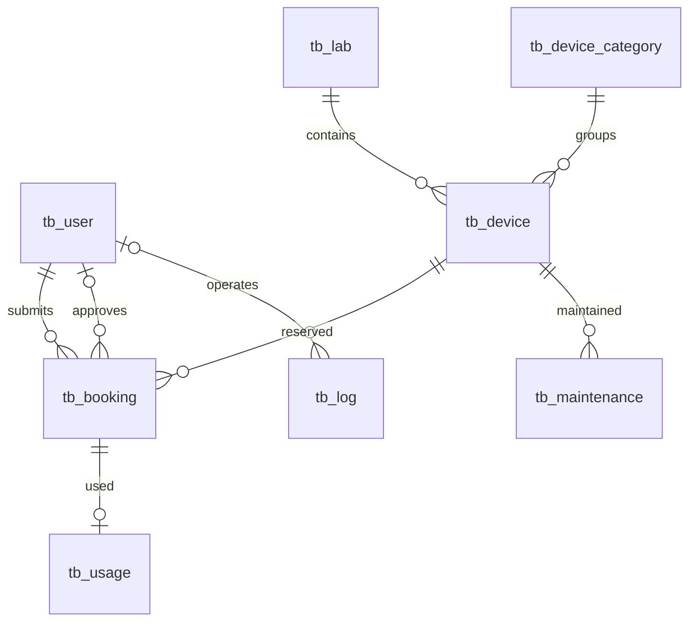
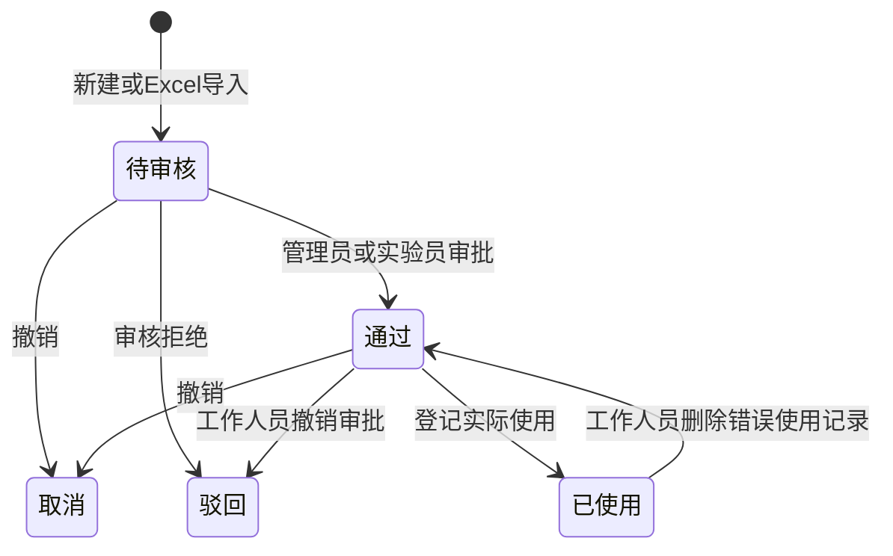

# 数据库设计与演示

## 实体关系



`schema.sql` 是完整字段、主外键、索引和数据库对象定义的唯一来源。实体字段与原开题报告基本一致，有两处必要调整：使用记录不重复保存用户和设备，而是经预约关联取得；维保增加状态和完成时间，以表达处理中与已完成。

数据库采用 InnoDB、utf8mb4。用户名、分类名称、实验室名称和设备编号唯一；关联记录默认禁止直接删除被引用实体。金额使用 DECIMAL(10,2)，不以浮点数存储。MySQL 5.7 不可靠执行 CHECK 约束，时间先后及非负金额由 Service 校验；预约审批流程和冲突查询通过存储过程执行。

## 状态流转



使用记录实际结束为空表示尚未结束，填写结束时间后成为完整记录。维保“处理中”阻止预约与新使用登记，完成按钮填写完成时间。一个设备有多条处理中维保时，完成其中一条不会提前恢复设备。

## 数据库对象的现场查询

以下语句均可在 MySQL 客户端直接演示：

```sql
SHOW TABLES;
SHOW CREATE TABLE tb_booking;
SHOW CREATE TABLE tb_usage;
SHOW TRIGGERS;
SHOW PROCEDURE STATUS WHERE Db = DATABASE();

SELECT * FROM v_device_status;
SELECT * FROM v_booking_detail ORDER BY booking_id DESC LIMIT 10;
SELECT * FROM v_usage_detail ORDER BY usage_id DESC LIMIT 10;
SELECT * FROM v_maintenance_summary ORDER BY maintain_id DESC LIMIT 10;

SET @conflicts = 0;
CALL sp_check_time_conflict(1, '2027-01-01 09:00:00', '2027-01-01 10:00:00', 0, @conflicts);
SELECT @conflicts;
CALL sp_monthly_usage_stat(DATE_SUB(CURDATE(), INTERVAL 6 MONTH), DATE_ADD(CURDATE(), INTERVAL 1 DAY));

SELECT l.lab_name, COUNT(d.device_id) AS device_count
FROM tb_lab l LEFT JOIN tb_device d ON d.lab_id=l.lab_id
GROUP BY l.lab_id,l.lab_name;
```

## 建议的10分钟演示顺序

1. 双击 `start-demo.bat`，用管理员登录，展示5条设备、5个实验室、5个分类。说明 MySQL 数据表与外键关系。
2. 在设备台账新增 `DEMO001`，名称“演示仪器”，分类和实验室任选。再修改型号，用关键词查询。
3. 在预约页新增一条预约，选择 `DEMO001`，起始使用当前时间、结束使用一小时后。再次添加重叠时段，展示冲突提示。
4. 对第一条预约“审批通过”。在使用记录页确认还没有自动新增使用记录，说明审批和实际使用分开。
5. 回预约页点击“登记使用”，起始时间保留预约时间。到使用记录页选中刚新增的记录，点击“结束使用”，结束时间应晚于实际开始。
6. 在维保页给该设备新增维修，展示设备状态变为“维修中”。尝试新预约，展示拒绝提示；完成维保后设备恢复正常。
7. 打开设备导入模板，填入一条 `EXCEL001` 设备，分类和实验室ID选已有数据。导入并展示结果。再填重复编号或不存在的分类，展示错误行号及整批回滚。
8. 在预约、维保页分别展示导入模板和查询导出文件，说明三类数据均支持导入导出。
9. 打开统计图表，点击“生成统计图”，说明使用频次统计来源于实际使用记录，而不是审批数量。
10. 查看操作日志；退出登录用 student1 登录，展示其只可编辑自己的预约与使用记录，不能管理基础资料。

预约可以补录历史，因此不用等待未来预约时间才演示登记。实际开始必须位于预约时段内，实际结束必须晚于实际开始。

## 事务回滚的实训解释

Excel导入以整个文件为一个事务，每一行设置保存点。如果某行失败，回到该行保存点并记录错误；完成检查后只要有任何错误，整个文件事务回滚。这样可以说明事务、保存点、参照完整性和业务校验的区别。日志与业务数据使用同一连接和事务，回滚的业务不会留下“已成功导入”的日志。

初始化的建表、建视图与存储过程属于MySQL DDL，会隐式提交，不能用普通事务声称整个初始化可回滚。因此初始化只接受空数据库，并拒绝覆盖既有数据。
